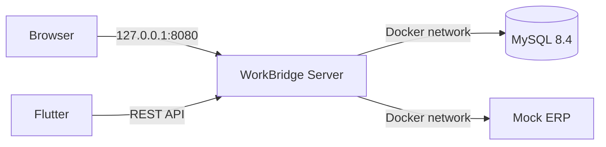

# 구성

WorkBridge는 세 개의 실행 구성으로 나뉩니다.

- `server`: JSP 화면, REST API, 인증, 업무 처리
- `mock-erp`: ERP 응답과 실패 상황 확인
- `mysql`: 업무 데이터와 로그 저장

Flutter 앱은 `server`의 REST API를 사용합니다.

## 실행 구조

기본 Compose 설정에서는 MySQL과 Mock ERP 포트를 호스트에 열지 않습니다. 서버도 `127.0.0.1`에만 바인딩합니다.

## 서버 구성

| 구분 | 역할 |
|---|---|
| JSP Controller | 화면 경로와 초기 모델 구성 |
| REST Controller | 요청 검증, HTTP 응답 변환 |
| Service | 트랜잭션, 상태 변경, 권한과 소유권 검사 |
| Domain | 결재 상태, 영업 단계, 값 검증 |
| Repository, Mapper | MyBatis SQL과 데이터 변환 |
| Integration | ERP 요청 생성, HTTP 호출, 결과 분류 |
| Migration | CSV 파싱, Staging, 검증, 반영 |
| Audit, Error | Trace ID 기준 변경과 오류 기록 |

Controller에서는 상태 전이와 외부 호출을 처리하지 않습니다. 업무 규칙과 트랜잭션은 Service에 두고, SQL 조건은 Mapper에 명시합니다.

## 인증과 권한

JSP는 세션과 CSRF를 사용합니다. Flutter API는 Access Token과 Refresh Token을 사용합니다. 두 채널 모두 같은 직원, 역할, 메뉴 데이터를 조회합니다.

권한은 다음 순서로 확인합니다.

1. `SecurityFilterChain`에서 URL 접근 확인
2. 필요한 경우 `@PreAuthorize` 확인
3. Service에서 담당자, 요청자, 승인자, 현재 상태 확인
4. JSP 메뉴는 조회 결과에 따라 표시

메뉴가 숨겨져 있어도 API와 Service 검사는 그대로 수행합니다.

## 상태 변경과 동시성

결재, 고객, 영업기회 수정은 현재 `version`을 조건으로 UPDATE합니다. 결재 승인과 반려는 승인자, 상태, 버전까지 함께 확인합니다. 갱신 건수가 0이면 이미 처리됐거나 다른 요청이 먼저 변경한 것으로 보고 `409 Conflict`를 반환합니다.

현재 상태와 이력은 분리합니다.

- `approval_request`: 결재 현재 상태
- `approval_history`: 결재 처리 이력
- `external_interface_log`: ERP 전송의 최종 상태
- `external_interface_attempt`: 각 HTTP 호출 결과
- `migration_batch`: CSV 작업 상태
- `migration_staging`, `migration_error`: 행별 검증 결과

## ERP 전송

1. 승인 완료 여부와 업무 버전을 확인합니다.
2. Idempotency Key로 인터페이스 원장을 생성합니다.
3. HTTP 호출은 긴 DB 트랜잭션 밖에서 수행합니다.
4. 4xx는 영구 오류, 5xx와 타임아웃은 일시 오류로 분류합니다.
5. 호출 결과와 재시도 이력을 별도 테이블에 저장합니다.

Mock ERP 관리 API는 인증이 없으므로 Docker 내부 네트워크에서만 사용합니다.

## CSV 이관

1. 파일 크기, UTF-8, 헤더를 확인합니다.
2. SHA-256으로 동일 파일 여부를 확인합니다.
3. 원본 행을 Staging에 저장합니다.
4. 사업자번호, 이메일, 날짜, 담당자를 검증합니다.
5. 정상 행만 한 트랜잭션으로 반영합니다.
6. 오류 행은 오류 CSV로 제공합니다.

## Trace ID

요청마다 Trace ID를 생성하거나 전달받습니다. API 응답, 감사 로그, 시스템 오류, ERP 시도 이력에 같은 값을 저장해 한 요청의 흐름을 찾을 수 있습니다.

## 패키징과 실행

`server`는 실행 가능한 WAR로 빌드합니다. Docker에서는 `java -jar`로 실행합니다. 로컬에서는 MySQL만 Docker로 실행하고 서버와 Mock ERP를 Maven으로 실행할 수도 있습니다.

외부 배포는 현재 Compose 범위에 포함하지 않습니다. HTTPS, 비밀값 관리, 샘플 계정 제거, 방화벽, 로그 보관과 백업 정책이 추가로 필요합니다.
