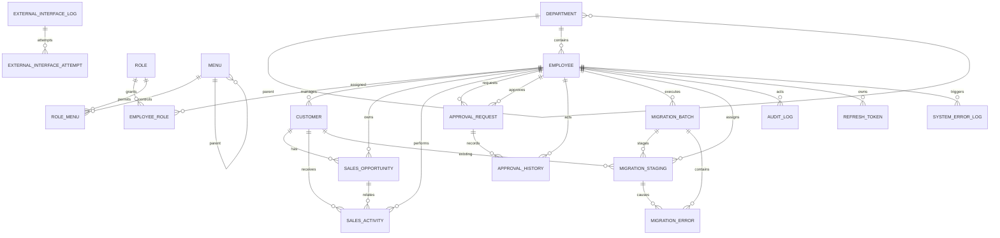

# 데이터 모델

## 설계 기준

- 내부 PK는 관계, 조인에 단순한 `BIGINT AUTO_INCREMENT`를 사용합니다.
- 사번, 로그인 ID, 부서코드, 역할코드, 사업자번호, 결재번호, 영업기회번호, Idempotency Key, 이관 배치번호는 업무상 UNIQUE KEY로 관리합니다.
- 상태를 보유하는 업무 테이블과 변경 과정을 남기는 이력 테이블을 분리합니다.
- 외부 시스템 통신 전문은 고객, 기회, 결재 테이블에 섞지 않고 인터페이스 전용 테이블에 저장합니다.
- CSV는 운영 고객 테이블로 바로 반영하지 않고 Staging에서 정규화, 검증합니다.
- 수정 충돌 가능성이 있는 기준, 영업, 결재, 인터페이스, 이관 배치에는 `version`을 둡니다.
- 업무 이력은 물리 삭제하지 않고 활성 상태 또는 업무 상태로 통제합니다.

## 전체 ERD

`approval_request.business_type/business_id`와 `external_interface_log.business_type/business_id`는 여러 업무 유형을 수용하기 위한 논리적 참조입니다. 현재 구현은 `OPPORTUNITY`만 허용하며 Service에서 존재와 상태를 검증합니다. 데이터베이스 FK를 두지 않은 이유는 다형 관계를 한 FK로 표현할 수 없기 때문입니다.

## 테이블 목록

| 영역 | 테이블 | 목적 |
|---|---|---|
| 조직 | `department` | 계층형 부서와 활성 상태 |
| 조직 | `employee` | 로그인 계정, 소속, 잠금, 상태 |
| 권한 | `role`, `employee_role` | 역할과 직원의 다대다 관계 |
| 권한 | `menu`, `role_menu` | 메뉴 트리와 역할별 읽기, 쓰기 권한 |
| 영업 | `customer` | 고객과 담당 영업사원 |
| 영업 | `sales_opportunity` | 영업단계, 예상매출, 확률, 담당자 |
| 영업 | `sales_activity` | 방문, 회의, 통화, 이메일 활동 |
| 결재 | `approval_request` | 결재 현재 상태와 요청 데이터 |
| 결재 | `approval_history` | 생성, 요청, 승인, 반려, 취소 이력 |
| 연동 | `external_interface_log` | 업무 단위의 인터페이스 상태, 전문 |
| 연동 | `external_interface_attempt` | 각 HTTP 호출 시도와 결과 |
| 이관 | `migration_batch` | 파일, 실행자, 상태, 집계 |
| 이관 | `migration_staging` | 행별 원본, 정규화, 검증, 반영 유형 |
| 이관 | `migration_error` | 행, 필드별 복수 오류 |
| 운영 | `audit_log` | 주요 변경의 전후 값, Trace ID |
| 인증 | `refresh_token` | 회전형 Refresh Token 해시, 폐기 관계 |
| 운영 | `system_error_log` | API 오류의 안전한 운영 추적 |

총 19개 업무 테이블이며 Flyway 자체의 `flyway_schema_history`는 업무 테이블 수에서 제외합니다.

## 핵심 키와 제약조건

### 조직, 권한

- `department.department_code` UNIQUE
- `employee.employee_no`, `login_id`, `email` UNIQUE
- `role.role_code`, `menu.menu_code` UNIQUE
- `employee_role`, `role_menu`는 복합 PK로 중복 배정 방지
- 마지막 활성 ADMIN 보호는 단순 제약으로 표현하기 어려워 Service 트랜잭션과 `SELECT ... FOR UPDATE`로 처리

### 영업

- `customer.business_registration_no` UNIQUE
- `sales_opportunity.opportunity_no` UNIQUE
- 고객 상태와 `active` 조합, 영업단계, 상태, 확률 조합은 Java 규칙과 CHECK 제약으로 이중 방어
- 고객, 기회, 활동의 `version`은 조건부 UPDATE에 사용

### 결재

- `approval_request.approval_no` UNIQUE
- 상태: `DRAFT`, `REQUESTED`, `APPROVED`, `REJECTED`, `CANCELED`
- 상태 전이는 Service에서 검증하고 UPDATE의 `status`, `version`, 행위자 ID 조건으로 중복 처리 방지
- `approval_history`는 상태 변경 시 같은 업무 트랜잭션 안에서 저장

### 외부 인터페이스

- `external_interface_log.idempotency_key` UNIQUE
- 업무 버전이 같으면 같은 키를 재사용하고, 업무 데이터가 변경되어 버전이 증가한 경우에만 새 키 사용
- `external_interface_attempt`는 인터페이스 한 건의 자동 재시도, 수동 재처리 호출을 각각 보존

### 데이터 이관

- `migration_batch.batch_no` UNIQUE
- V7의 `dedup_key` UNIQUE로 같은 SHA-256 파일의 동시 중복 실행 방지
- `migration_staging(batch_id, row_no)` UNIQUE
- `migration_error`는 한 행에서 여러 필드 오류를 저장할 수 있도록 별도 PK 사용

### 모바일 인증

- `refresh_token.token_hash` UNIQUE
- 원문 토큰은 저장하지 않음
- 회전 시 `replaced_by_token_id`, `revoked_at`을 기록
- 활성 토큰 조회에는 해시, 폐기, 만료 인덱스를 사용

## 주요 인덱스

| 조회 목적 | 인덱스 예시 |
|---|---|
| 직원 검색, 잠금 | `(department_id, active)`, `(employee_name, active)`, `locked_until` |
| 고객 목록 | `(customer_name, active)`, `(assigned_sales_id, status, active)`, `contact_name` |
| 영업기회 | `(owner_employee_id, status, stage)`, `(customer_id, created_at)`, `(expected_close_date, status)` |
| 활동 | `(customer_id, activity_at)`, `(opportunity_id, activity_at)`, `(employee_id, activity_at)` |
| 결재 | `(approver_id, status, requested_at)`, `(requester_id, status, created_at)`, `(business_type, business_id)` |
| 인터페이스 | `(status, next_retry_at)`, `(business_type, business_id, created_at)`, `trace_id` |
| 이관 | `(status, started_at)`, `(batch_id, validation_status)`, `(batch_id, business_registration_no)` |
| 운영 | `audit_log.trace_id`, `system_error_log.trace_id`, 오류 상태, 발생시각 |

인덱스 효과는 실제 MySQL의 데이터 분포와 `EXPLAIN` 결과를 확인한 뒤 판단해야 합니다. 특히 활동 제목, 내용의 `%검색어%` 조건은 일반 B-tree 인덱스 이점을 충분히 받지 못하므로 데이터 증가 시 Full-Text Search를 검토합니다.

## 상태 이력을 분리한 이유

`approval_request`만 갱신하면 현재 상태는 알 수 있지만 누가 언제 어떤 상태에서 어떤 의견으로 처리했는지 복원할 수 없습니다. 따라서 현재 상태는 빠른 목록 조회를 위해 요청 테이블에 두고, 모든 행위는 `approval_history`에 append-only 방식으로 남깁니다.

같은 이유로 외부 연동은 업무 단위의 최종 상태를 `external_interface_log`에 두고, 실제 호출별 HTTP 결과는 `external_interface_attempt`에 분리합니다. 자동 재시도와 수동 재처리의 순서를 잃지 않으면서 운영 목록은 한 행으로 빠르게 조회할 수 있습니다.

## Staging Table을 사용한 이유

CSV 한 행을 곧바로 `customer`에 반영하면 뒤쪽 행의 오류가 발견되었을 때 정상, 오류 범위와 원본을 추적하기 어렵습니다. `migration_staging`에는 원본, 정규화 값, 기존 고객 ID, 담당 영업사원 ID, 검증 상태와 INSERT/UPDATE/NONE 판정을 저장합니다.

이 구조를 통해 오류 행은 그대로 보존하고 정상 집합만 별도 적용 트랜잭션에서 반영합니다. 정상 집합 적용 중 기술 오류가 발생하면 해당 집합을 롤백하고 배치를 `FAILED`로 기록합니다.

## 개인정보와 로그

- 비밀번호, Access Token, Refresh Token 원문은 로그와 감사 데이터에 저장하지 않습니다.
- Refresh Token은 SHA-256 해시만 저장합니다.
- 감사 로그의 로그인 ID, 이메일, 전화, 사업자번호, 직원명은 부분 마스킹합니다.
- 인터페이스 요청, 응답 전문은 키 이름 기반 마스킹과 길이 제한을 적용합니다.
- 시스템 오류 테이블에는 Stack Trace 대신 오류 코드, 안전한 메시지, Trace ID, 요청 경로를 저장합니다.

## Flyway 버전

| 버전 | 내용 |
|---|---|
| V1 | 18개 기본 테이블, PK, FK, UNIQUE, CHECK, 인덱스 |
| V2 | 부서, 역할, 직원, 메뉴, 권한, 개발 계정 |
| V3 | 영업활동 메뉴, 권한, 영업 정합성 CHECK, 검색 인덱스 |
| V4 | 가상 고객, 기회, 활동 데이터 |
| V5 | 결재 데모 데이터, Refresh Token 조회 인덱스 |
| V6 | `external_interface_attempt` |
| V7 | 이관 dedup key와 구조화된 Staging 컬럼 |
| V8 | 운영 조회 인덱스 |

이미 적용한 Flyway 파일을 수정하지 않고 새 버전을 추가하는 원칙을 사용합니다.
